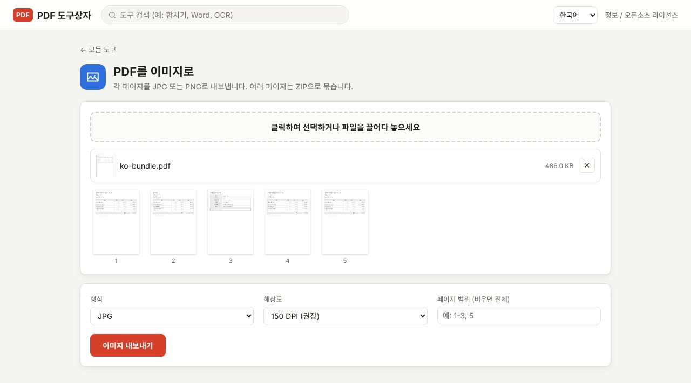
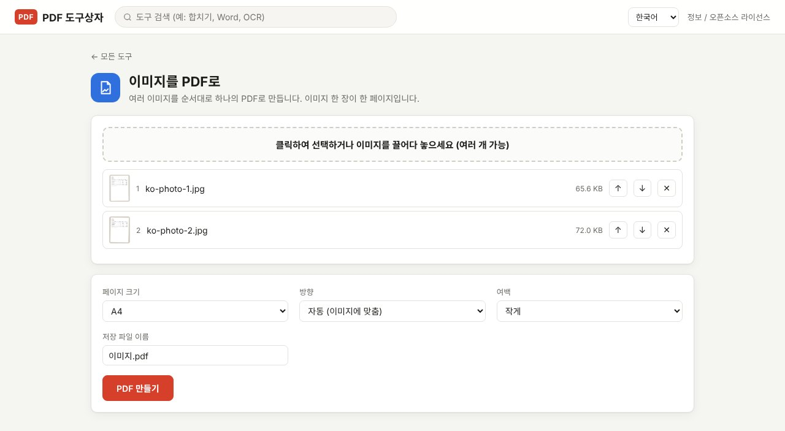

PDF를 이미지로, 이미지를 PDF로 바꾸는 일은 생각보다 자주 생깁니다. 상세페이지나 블로그에 문서 한 장을 그림으로 올릴 때, 반대로 휴대폰으로 찍은 영수증 사진들을 PDF 한 개로 제출해야 할 때입니다. PDF Toolbox에는 두 방향 모두 있고, 파일은 내 컴퓨터 밖으로 나가지 않습니다.

> **준비물**: [PDF Toolbox 최신 버전 다운로드](https://github.com/toolboxnotes/pdf-toolbox/releases/latest) (무료, Windows·Mac). 설치 방법은 [PDF Toolbox 소개 글](../offline-pdf-toolbox/)의 "다운로드와 설치"를 참고하세요.

## PDF를 JPG로: PDF를 이미지로

*5페이지짜리 PDF를 넣은 화면. 형식, 해상도, 페이지 범위를 고릅니다.*

1. **PDF를 끌어다 놓고 PDF를 이미지로를 고릅니다.** 페이지 썸네일이 나옵니다.
2. **형식을 고릅니다.** JPG(용량이 작음) 또는 PNG(글자 테두리가 선명하고 용량이 큼).
3. **해상도를 고릅니다.** 기준은 아래 표를 보세요.
4. **필요한 페이지만 적습니다.** 비워 두면 전체, 예: `1-3, 5`
5. **이미지 내보내기**를 누릅니다. 한 페이지면 이미지 한 장이, 여러 페이지면 `원래이름_01.jpg`, `원래이름_02.jpg`… 가 `원래이름_이미지.zip`으로 묶여 저장됩니다.

| 해상도 | 쓰임새 |
|---|---|
| 72 DPI (작게) | 메신저로 미리 보기 보낼 때, 썸네일 |
| 150 DPI (권장) | 블로그·상세페이지에 올릴 때, 화면으로 볼 때 |
| 300 DPI (고화질) | 인쇄할 때, 작은 글씨까지 확대해서 봐야 할 때 |

글자가 많은 문서를 이미지로 올린다면 PNG가 더 선명합니다. 사진이 많은 페이지는 JPG가 용량 대비 효율이 좋습니다.

## JPG를 PDF로: 이미지를 PDF로

*휴대폰으로 찍은 문서 사진 두 장(가상)을 넣은 화면. 이미지 한 장이 한 페이지가 됩니다.*

1. **이미지를 PDF로를 고르고 사진을 모두 끌어다 놓습니다.** 여러 장을 한 번에 넣을 수 있고, JPG, PNG, WebP, GIF, BMP를 지원합니다.
2. **순서를 정합니다.** 목록 번호가 페이지 순서입니다. 드래그하거나 ↑ ↓ 버튼으로 바꿉니다.
3. **페이지 크기·방향·여백을 고릅니다.**
   - **페이지 크기**: A4(기본), Letter, A3, 또는 이미지 크기 그대로
   - **방향**: 자동(이미지에 맞춤)이면 가로 사진은 가로 페이지로 들어갑니다
   - **여백**: 없음, 작게(기본), 크게
4. **저장 파일 이름**을 정하고 **PDF 만들기**를 누릅니다. 기본 이름은 `이미지.pdf`입니다.

휴대폰 사진의 회전 정보(EXIF)를 읽어서, 세로로 찍은 사진이 옆으로 누워 들어가지 않게 바로 세워 넣습니다.

## 제출용 PDF를 만들 때 팁

- **용량이 크면**: 휴대폰 사진은 한 장에 몇 MB씩이라 PDF도 커집니다. 만든 뒤 [PDF 용량 줄이기](../compress-pdf-offline/)의 "권장" 단계를 한 번 거치면 대부분 제출 한도 안에 들어갑니다.
- **글자를 검색하게 하려면**: 사진으로 만든 PDF는 글자가 그림이라 검색이 안 됩니다. [OCR](../scanned-pdf-searchable-ocr/)을 실행하면 검색 가능한 PDF가 됩니다.
- **기존 PDF에 사진을 끼워 넣으려면**: 사진을 PDF로 만든 다음 [PDF 합치기](../merge-pdf-offline/)로 붙이면 됩니다.

## 알아 둘 한계

- **아이폰 HEIC 사진은 바로 넣을 수 없습니다.** 아이폰 설정 → 카메라 → 포맷에서 "높은 호환성"을 고르면 JPG로 찍히고, 이미 찍은 사진은 공유할 때 JPG로 바뀌는 경우가 많습니다.
- **PDF를 이미지로 바꾸면 글자 선택이 안 됩니다.** 이미지이기 때문입니다. 글자를 그대로 쓰려면 [PDF 엑셀 변환](../pdf-to-excel-offline/)이나 PDF → Office의 Word 변환이 맞습니다.

## 자주 묻는 질문

### 특정 페이지 하나만 이미지로 저장할 수 있나요?

"페이지 범위"에 그 페이지 번호만 적으면 됩니다. 예: `3`

### 이미지 순서를 잘못 넣었어요.

PDF를 만들기 전이라면 목록에서 드래그로 바꾸면 됩니다. 이미 만들었다면 **페이지 정리** 도구에서 페이지 순서를 바꿀 수 있습니다.

### PDF 전체를 이미지로 된 PDF로 만들고 싶어요.

이미지 파일이 아니라 "복사·수정이 안 되는 PDF"가 목적이라면 **이미지 기반 PDF** 도구가 맞습니다. 페이지를 이미지로 바꿔 PDF로 다시 만들어 줍니다.

## 함께 보면 좋은 글

- [PDF 용량 줄이기](../compress-pdf-offline/)
- [스캔 PDF 검색 가능하게 만들기 (무료 OCR)](../scanned-pdf-searchable-ocr/)
- [PDF 합치기](../merge-pdf-offline/)
- [무료 오프라인 PDF 변환기 PDF Toolbox 전체 기능](../offline-pdf-toolbox/)
