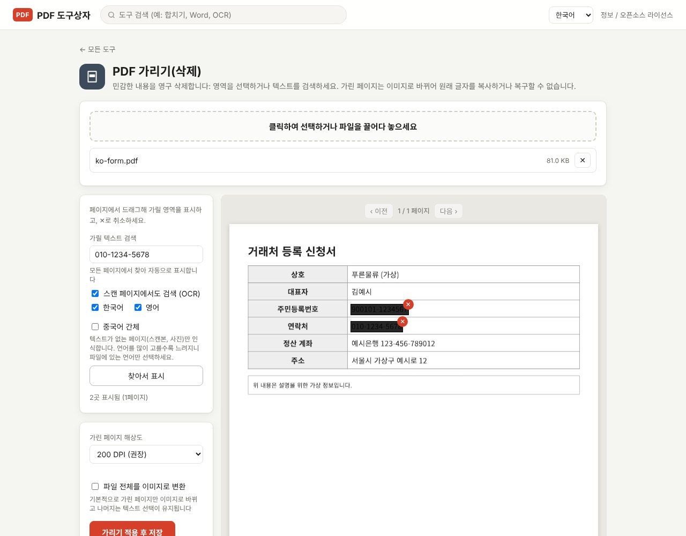

PDF에서 주민등록번호 위에 검은 사각형을 그려 넣는 것만으로는 정보가 지워지지 않습니다. 사각형은 글자 위에 얹힌 별도의 도형일 뿐이라, 아래 글자는 파일 안에 그대로 남아 복사와 검색이 됩니다. 정보를 실제로 없애려면 해당 영역의 내용 자체를 제거해야 하고, 이 글에서는 그 방법과 제대로 지워졌는지 확인하는 방법을 정리합니다.

> **준비물**: [PDF Toolbox 최신 버전 다운로드](https://github.com/toolboxnotes/pdf-toolbox/releases/latest) (무료, Windows·Mac). 파일은 내 컴퓨터 안에서만 처리됩니다.

## 검은 칠만 하면 왜 위험한가

PDF의 한 페이지는 글자, 이미지, 도형이 층층이 쌓인 구조입니다. 편집 프로그램에서 검은 사각형이나 형광펜을 추가하면 맨 위에 도형이 하나 더 올라갈 뿐, 그 아래 글자는 손대지 않습니다. 그래서 다음과 같은 일이 가능합니다.

- 가린 부분을 포함해 드래그한 뒤 복사해서 붙여 넣으면 원래 글자가 나온다.
- Ctrl+F로 가린 이름이나 번호를 검색하면 검색 결과에 잡힌다.
- PDF 편집 프로그램에서 사각형만 선택해 삭제하면 원문이 다시 보인다.

Word에서 글자 배경을 검게 칠한 뒤 PDF로 저장한 파일도 마찬가지입니다. 화면에서 안 보이는 것과 파일에서 없어진 것은 다릅니다.

## 내가 받은(보낼) 파일이 제대로 가려졌는지 30초 확인

1. PDF를 열고 Ctrl+A로 전체 선택한 뒤 복사합니다.
2. 메모장에 붙여 넣습니다.
3. 가려져 있어야 할 이름, 번호가 메모장에 보이면 그 파일은 가려지지 않은 것입니다.

이미 그렇게 보낸 파일이 있다면, 받은 쪽에서 같은 방법으로 내용을 볼 수 있다는 뜻입니다.

## 복구할 수 없게 지우는 순서

*가상의 거래처 등록 신청서에서 주민등록번호와 전화번호를 "가릴 텍스트 검색"으로 찾아 표시한 모습. "2곳 표시됨 (1페이지)"로 개수를 확인할 수 있습니다.*

1. **PDF Toolbox에 파일을 끌어다 놓고 "PDF 가리기(삭제)"를 고릅니다.** 보안 분류 안에 있습니다.
2. **가릴 곳을 표시합니다.** 방법은 두 가지이고 함께 써도 됩니다.
   - **드래그**: 페이지에서 마우스로 영역을 끌어 표시합니다. 잘못 표시한 곳은 ✕로 취소합니다.
   - **텍스트 검색**: "가릴 텍스트 검색"에 전화번호나 이름을 입력하고 **찾아서 표시**를 누르면 모든 페이지에서 찾아 한꺼번에 표시합니다.
3. **스캔 문서라면 "스캔 페이지에서도 검색 (OCR)"이 켜져 있는지 확인합니다.** 기본으로 켜져 있으며, 이미지로 된 페이지의 글자도 인식해서 찾아 줍니다.
4. **표시된 개수와 페이지 수를 확인합니다.** 화면에 "N곳 표시됨 (M페이지)"로 나옵니다.
5. **가리기 적용 후 저장**을 누릅니다. 파일 이름 뒤에 `_가림.pdf`가 붙은 새 파일이 저장되고 원본은 그대로 남습니다.

## 이 도구가 지우는 방식

가린 영역이 있는 페이지를 통째로 이미지로 다시 만듭니다. 검은 칠이 이미지에 그려진 상태가 되므로, 그 페이지에는 복사하거나 꺼낼 수 있는 글자가 남지 않습니다.

- 기본 설정에서는 **가린 페이지만** 이미지로 바뀌고, 나머지 페이지는 텍스트 선택과 검색이 그대로 유지됩니다.
- 문서 전체를 선택·복사할 수 없게 하려면 **파일 전체를 이미지로 변환**을 켭니다.
- 이미지로 바뀐 페이지가 흐릿하면 **가린 페이지 해상도**를 높입니다. 해상도를 높이면 용량도 늘어납니다.

## 저장한 뒤 꼭 해야 할 확인

1. `_가림.pdf` 파일을 열어 위의 "30초 확인"을 다시 해 봅니다.
2. Ctrl+F로 가린 단어를 검색해 결과가 0건인지 봅니다.
3. 같은 정보가 다른 페이지(머리글, 서명란, 첨부 서류)에 또 있는지 넘겨 봅니다. 검색으로 표시하면 빠뜨릴 가능성이 줄어듭니다.
4. 파일 이름에 개인정보가 들어 있지 않은지 확인합니다. `홍길동_주민등록등본.pdf` 같은 이름은 내용과 별개로 그대로 전달됩니다.

## 알아 둘 한계

- **가린 페이지는 검색이 안 됩니다.** 이미지로 바뀌기 때문입니다. 필요하면 저장한 파일에 [OCR을 실행](../scanned-pdf-searchable-ocr/)해 검색 기능을 되살릴 수 있고, 이때 가린 부분은 이미 검은 그림이라 인식되지 않습니다.
- **"흰색 가림"은 삭제가 아닙니다.** "편집 / 서명" 도구의 흰색 가림은 보기 좋게 덮는 용도이고 원래 글자는 파일에 남습니다. 개인정보에는 반드시 "PDF 가리기(삭제)"를 쓰세요.
- **텍스트 검색은 입력한 문자열과 일치하는 것만 찾습니다.** `010-1234-5678`과 `01012345678`은 따로 검색해야 합니다. 주민등록번호 형식을 자동으로 찾아 주는 기능은 없습니다.
- **원본은 지워지지 않습니다.** 가리기 전 원본 파일은 직접 관리해야 합니다. 메일에 원본을 첨부하는 실수가 가장 흔합니다.

## 자주 묻는 질문

### 가린 내용을 나중에 되돌릴 수 있나요?

저장된 `_가림.pdf`에서는 되돌릴 수 없습니다. 그래서 원본을 따로 보관해야 합니다.

### 검은색 말고 흰색으로 지울 수 있나요?

이 도구는 검은색으로 가립니다. 흰색으로 덮는 기능은 "편집 / 서명" 도구에 있지만 삭제가 아니라 덮기입니다.

### 스캔한 PDF도 가릴 수 있나요?

됩니다. 드래그로 표시하거나, "스캔 페이지에서도 검색 (OCR)"을 켠 상태에서 텍스트로 찾으면 됩니다.

### 온라인 사이트에서 해도 되지 않나요?

가리려는 파일은 그 자체가 개인정보입니다. 가리기 위해 가리기 전 원본을 다른 서버에 올리는 것은 순서가 맞지 않다고 생각해, 내 컴퓨터에서만 처리하도록 만들었습니다.

## 함께 보면 좋은 글

- [스캔 PDF 검색 가능하게 만들기 (무료 OCR)](../scanned-pdf-searchable-ocr/)
- [PDF 비밀번호 설정과 해제 방법](../pdf-password-protect-unlock/)
- [무료 오프라인 PDF 변환기 PDF Toolbox 전체 기능](../offline-pdf-toolbox/)
