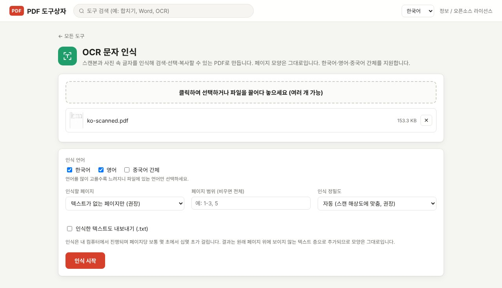

스캔한 PDF에서 Ctrl+F가 먹히지 않는 이유는 페이지 전체가 한 장의 사진이기 때문입니다. OCR(문자 인식)로 사진 위에 보이지 않는 텍스트 층을 얹으면 모양은 그대로 두고 검색·선택·복사가 됩니다. 이 글에서는 파일을 어디에도 올리지 않고 내 컴퓨터에서 무료로 처리하는 방법을 정리합니다.

> **준비물**: [PDF Toolbox 최신 버전 다운로드](https://github.com/toolboxnotes/pdf-toolbox/releases/latest) (무료, Windows·Mac). 설치 방법은 [PDF Toolbox 소개 글](../offline-pdf-toolbox/)의 "다운로드와 설치"를 참고하세요.

## 내 PDF가 스캔본인지 확인하는 법

OCR이 필요한 파일인지는 10초면 알 수 있습니다.

- 마우스로 글자를 드래그했을 때 글자 단위로 선택되지 않고 페이지 전체가 선택된다.
- Ctrl+F(Mac은 Cmd+F)로 본문에 분명히 있는 단어를 찾아도 결과가 0건이다.
- 글자를 복사해 메모장에 붙여 넣으면 아무것도 나오지 않는다.

셋 중 하나라도 해당하면 스캔본(이미지 PDF)입니다. 복합기에서 "PDF로 스캔"한 계약서, 휴대폰으로 찍어 만든 영수증 PDF, 팩스로 받은 문서가 대부분 여기에 속합니다.

## 검색 가능한 PDF를 만드는 순서

*스캔한 견적서(가상 문서)를 넣은 OCR 문자 인식 화면. 한국어 화면에서는 한국어와 영어가 기본으로 선택됩니다.*

1. **PDF Toolbox를 열고 첫 화면의 상자에 PDF를 끌어다 놓습니다.** 쓸 수 있는 도구가 나열되면 **OCR 문자 인식**을 고릅니다. 위쪽 검색창에 "OCR"을 입력해도 됩니다.
2. **인식 언어를 확인합니다.** 한국어 화면에서는 한국어와 영어가 기본으로 선택되어 있습니다. 한국어, 영어, 중국어 간체 중에서 문서에 실제로 있는 언어만 체크합니다. 한글 문서에 영문 상품명이나 숫자가 섞여 있으면 한국어와 영어를 함께 고르면 됩니다.
3. **인식할 페이지를 정합니다.** 기본값인 **텍스트가 없는 페이지만 (권장)** 을 그대로 두면, 이미 텍스트가 있는 페이지는 건드리지 않고 스캔 페이지만 인식합니다.
4. **인식 정밀도는 "자동"으로 둡니다.** 글씨가 아주 작은 문서만 **정밀 (400 DPI, 작은 글씨용)** 으로 바꿉니다.
5. **인식 시작**을 누릅니다. 끝나면 원래 파일 이름 뒤에 `_OCR.pdf`가 붙은 파일이 다운로드 폴더에 저장됩니다.

결과 파일을 열어 Ctrl+F로 단어를 찾아보면 바로 확인할 수 있습니다. 페이지 모양은 원본과 같고, 글자 위에 보이지 않는 텍스트가 한 겹 추가된 상태입니다.

## 설정값을 고르는 기준

| 설정 | 선택지 | 이럴 때 고르세요 |
|---|---|---|
| 인식 언어 | 한국어 / 영어 / 중국어 간체 | 문서에 있는 언어만. 많이 고를수록 느려집니다 |
| 인식할 페이지 | 텍스트가 없는 페이지만 (권장) / 모든 페이지 | 기존 텍스트가 깨져 있는 PDF만 "모든 페이지" |
| 인식 정밀도 | 자동 (권장) / 빠르게 200 / 표준 300 / 정밀 400 DPI | 각주나 표 안의 작은 글씨가 많으면 400 |
| 인식한 텍스트도 내보내기 (.txt) | 켜기 / 끄기 | 본문을 다른 문서에 붙여 넣을 계획이면 켜기 |

"자동"이 권장인 이유가 있습니다. 스캔한 해상도보다 크게 확대해서 인식하면 오히려 결과가 나빠집니다. 그래서 페이지에 들어 있는 스캔 이미지의 실제 픽셀 크기로 원래 해상도를 추정하고, 그 해상도에 맞춰 인식하도록 만들었습니다.

## 속도와 정확도, 실제로 써 보면

- **속도**: 페이지당 몇 초에서 십몇 초 정도입니다. 표와 한글·영문이 섞인 4페이지짜리 시험 문서는 3~5초가 걸렸습니다. 100페이지가 넘는 파일은 다른 작업을 하면서 기다리는 편이 낫습니다.
- **정확도**: 복합기로 반듯하게 스캔한 인쇄 문서는 검색에 쓰기에 충분합니다. 다만 아래 경우에는 오타가 늘어납니다.
  - 휴대폰으로 비스듬히 찍었거나 그림자가 진 문서
  - 얼룩이나 점이 많은 팩스 문서
  - 아주 큰 제목 글씨, 장식이 많은 글꼴
  - 손글씨 (인쇄체용 엔진이라 잘 인식하지 못합니다)

검색용으로는 약간의 오타가 있어도 쓸 만하지만, 금액이나 계좌번호처럼 한 글자가 중요한 내용은 반드시 원본 이미지와 눈으로 대조하세요.

## 스캔 PDF를 Word나 Excel로 바꾸려는 경우

검색 가능한 PDF를 먼저 만들 필요는 없습니다. **PDF → Office** 도구에 있는 **스캔 페이지 문자 자동 인식 (OCR)** 옵션이 기본으로 켜져 있어서, 스캔 페이지를 만나면 알아서 인식한 뒤 Word·Excel로 옮깁니다. 스캔한 견적서의 표를 Excel로 옮길 때 편합니다.

## 왜 온라인 OCR 사이트 대신 오프라인인가

스캔해서 보관하는 문서는 대개 계약서, 신분증 사본, 통장 사본, 진단서 같은 것들입니다. 온라인 OCR 서비스는 이런 파일을 서버로 보내 처리한 뒤 일정 시간 후 삭제한다고 안내합니다. 그 약속을 의심하는 것이 아니라, 애초에 보내지 않으면 걱정할 일이 없다는 쪽을 택했습니다.

PDF Toolbox는 인식 엔진과 언어 데이터가 프로그램 안에 들어 있어서 Wi-Fi를 끈 상태에서도 똑같이 동작합니다. 페이지 수나 하루 횟수 제한도 없습니다.

## 자주 묻는 질문

### 한글 인식이 되나요?

됩니다. 한국어, 영어, 중국어 간체를 지원합니다. 일본어 등 다른 언어는 아직 지원하지 않습니다.

### OCR을 하면 원본 화질이 떨어지나요?

떨어지지 않습니다. 페이지 이미지는 그대로 두고 보이지 않는 텍스트 층만 추가합니다. 파일 용량은 텍스트만큼만 조금 늘어납니다.

### 사진(JPG)으로 찍은 문서도 되나요?

먼저 **이미지를 PDF로** 도구로 PDF로 만든 다음 OCR을 실행하면 됩니다.

### 인식 결과의 오타를 고칠 수 있나요?

검색 가능한 PDF 안의 텍스트 층을 직접 고치는 기능은 없습니다. 수정이 필요하면 ".txt 내보내기"를 켜서 텍스트 파일을 고치거나, PDF → Office로 Word 문서로 바꿔 편집하세요.

### 휴대폰에서도 쓸 수 있나요?

Windows와 Mac용으로 만들었고, 휴대폰에서는 시험하지 않았습니다.

## 함께 보면 좋은 글

- [PDF 개인정보 가리기: 검은 칠만으로는 지워지지 않는 이유](../redact-pdf-permanently/)
- [PDF 비밀번호 설정과 해제 방법](../pdf-password-protect-unlock/)
- [무료 오프라인 PDF 변환기 PDF Toolbox 전체 기능](../offline-pdf-toolbox/)
