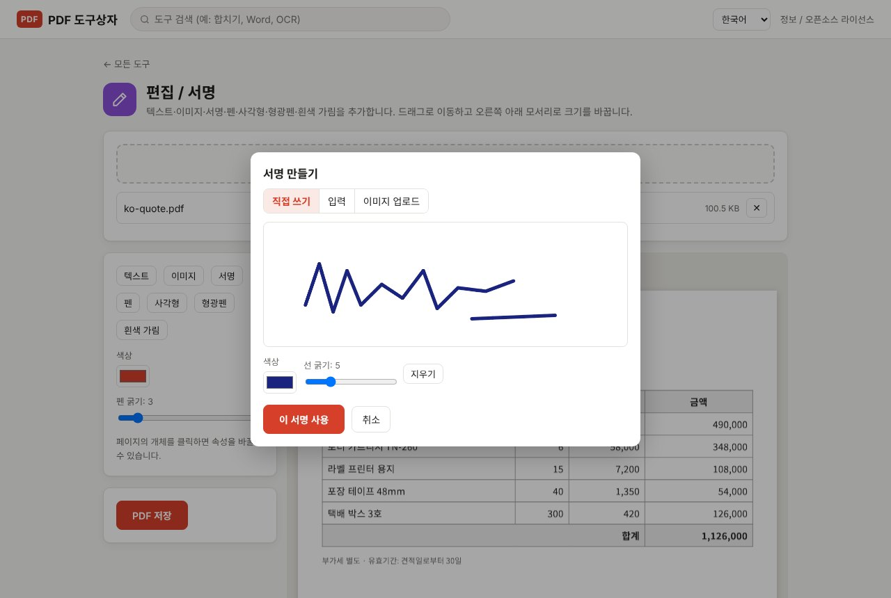
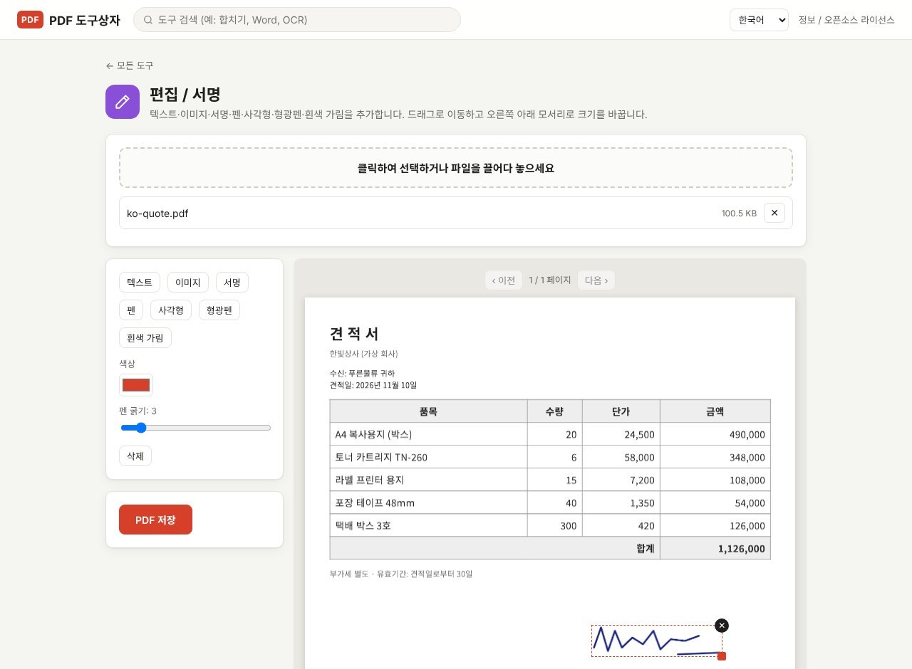

PDF 계약서 한 장에 사인하려고 프린트하고, 펜으로 쓰고, 다시 스캔하는 일은 이제 안 해도 됩니다. PDF Toolbox의 **편집 / 서명**에서 서명을 만들어 원하는 자리에 놓고 저장하면 끝입니다. 계약서는 내 컴퓨터 밖으로 나가지 않으니, 개인정보가 들어 있는 서류도 걱정 없이 쓸 수 있습니다.

> **준비물**: [PDF Toolbox 최신 버전 다운로드](https://github.com/toolboxnotes/pdf-toolbox/releases/latest) (무료, Windows·Mac). 설치 방법은 [PDF Toolbox 소개 글](../offline-pdf-toolbox/)의 "다운로드와 설치"를 참고하세요.

## 서명 만드는 세 가지 방법

*서명 만들기 창의 "직접 쓰기" 탭. 마우스나 터치패드로 서명을 씁니다.*

**편집 / 서명**에서 PDF를 연 뒤 **서명** 버튼을 누르면 **서명 만들기** 창이 열립니다. 탭이 세 개 있습니다.

| 탭 | 방법 | 이럴 때 |
|---|---|---|
| 직접 쓰기 | 마우스·터치패드·펜 태블릿으로 씁니다. **선 굵기**를 조절하고, 마음에 안 들면 **지우기** | 평소 쓰는 사인 그대로 넣고 싶을 때 |
| 입력 | **이름 입력**에 이름을 적고 **글꼴**을 고릅니다 (한글 손글씨, 영문 필기체 등) | 마우스로 쓰기 어려울 때, 깔끔한 서명이 필요할 때 |
| 이미지 업로드 | 종이에 쓴 서명을 찍은 사진이나 도장 이미지를 올립니다 | 이미 서명 이미지가 있을 때. **투명 배경 PNG가 가장 좋습니다** |

다 됐으면 **이 서명 사용**을 누릅니다.

## PDF에 서명 넣는 순서

*가상의 견적서 아래쪽에 서명을 놓은 화면. 선택된 서명에는 점선 테두리, 크기 조절 모서리, ✕ 버튼이 보입니다.*

1. **PDF를 끌어다 놓고 편집 / 서명을 고릅니다.**
2. **서명할 페이지로 이동합니다.** 미리 보기 위의 이전 / 다음으로 넘기며, 서명은 지금 보고 있는 페이지에 들어갑니다.
3. **서명을 만들고 이 서명 사용을 누릅니다.** 페이지 가운데쯤에 서명이 나타납니다.
4. **서명란으로 끌어다 놓습니다.** 오른쪽 아래 모서리를 끌면 크기가 바뀝니다. 잘못 넣었으면 ✕ 버튼이나 왼쪽의 **삭제**, 또는 Delete 키로 지웁니다.
5. **필요하면 날짜나 이름도 넣습니다.** **텍스트** 버튼을 누르고 왼쪽에서 글자를 고친 뒤 칸에 맞춰 옮기면 됩니다.
6. **PDF 저장**을 누릅니다. `원래이름_편집됨.pdf`로 저장되고, 원본은 그대로 남습니다.

## 서명 말고도 할 수 있는 것

같은 화면에서 서류 작업에 필요한 표시를 함께 할 수 있습니다.

- **텍스트**: 날짜, 이름, 체크 표시(✓) 넣기
- **이미지**: 회사 도장, 로고 넣기
- **펜**: 손으로 동그라미나 밑줄 그리기
- **사각형 / 형광펜**: 중요한 부분 표시
- **흰색 가림**: 잘못 적힌 부분을 흰색으로 덮기

입력 칸이 있는 PDF 양식이라면 칸에 바로 글자를 채우는 **양식 작성** 도구가 더 편합니다.

## 꼭 알아 둘 것

- **이 서명은 "그림으로 넣은 서명"입니다.** 공동인증서나 전자서명 서비스처럼 본인 확인이나 위·변조 검증 기능이 들어간 디지털 서명은 아닙니다. 상대방이 특정 전자서명 방식을 요구한다면 그 방식을 따라야 합니다. 일상적인 동의서, 견적 확인, 사내 서류처럼 "사인해서 PDF로 보내 주세요"라는 경우에 맞습니다.
- **흰색 가림은 글자를 지우지 않습니다.** 보이지만 않을 뿐 파일 안에 그대로 남아 복사할 수 있습니다. 개인정보를 정말 지우려면 [PDF 개인정보 가리기](../redact-pdf-permanently/)를 쓰세요.
- **보낸 뒤 서명이 옮겨지지 않게 하려면**: 저장한 PDF를 **이미지 기반 PDF**로 한 번 더 바꾸면 서명과 내용이 한 장의 이미지로 합쳐집니다. 대신 글자 선택은 안 됩니다.

## 자주 묻는 질문

### 여러 페이지에 서명해야 해요.

페이지를 옮겨 가며 **서명**을 다시 누르면 됩니다. 한 번에 저장하면 모든 페이지의 서명이 함께 들어갑니다.

### 서명 배경이 하얗게 네모로 보여요.

흰 종이에 쓴 서명 사진을 올리면 배경도 같이 들어갑니다. 배경을 지운 투명 PNG를 쓰거나, "직접 쓰기"로 새로 만드세요.

### 암호가 걸린 계약서는 어떻게 하나요?

먼저 [PDF 암호 해제](../pdf-password-protect-unlock/)로 암호를 푼 뒤 서명하고, 필요하면 다시 암호를 거세요.

### 서명한 PDF가 너무 커요.

[PDF 용량 줄이기](../compress-pdf-offline/)로 줄일 수 있습니다.

## 함께 보면 좋은 글

- [PDF 개인정보 가리기](../redact-pdf-permanently/)
- [PDF 비밀번호 설정·해제](../pdf-password-protect-unlock/)
- [PDF JPG 변환과 JPG PDF 변환](../pdf-to-jpg-and-jpg-to-pdf/)
- [무료 오프라인 PDF 변환기 PDF Toolbox 전체 기능](../offline-pdf-toolbox/)
