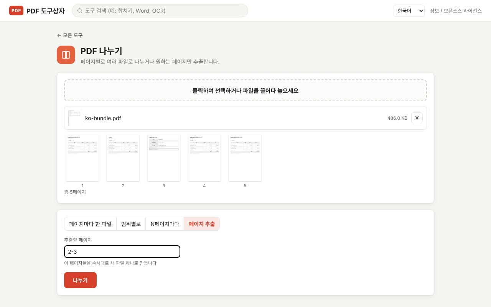

PDF에서 필요한 페이지만 따로 보내야 할 때가 많습니다. 50페이지짜리 계약서에서 서명 페이지만, 한 달 치 명세서 묶음에서 한 거래처 것만 떼어 내는 식입니다. PDF Toolbox의 **PDF 나누기**는 페이지마다 쪼개기, 범위별로 나누기, N페이지씩 자르기, 원하는 페이지만 추출하기의 네 가지 방식을 지원합니다. 파일은 내 컴퓨터 안에서만 처리됩니다.

> **준비물**: [PDF Toolbox 최신 버전 다운로드](https://github.com/toolboxnotes/pdf-toolbox/releases/latest) (무료, Windows·Mac). 설치 방법은 [PDF Toolbox 소개 글](../offline-pdf-toolbox/)의 "다운로드와 설치"를 참고하세요.

## 네 가지 나누기 방식

| 방식 | 하는 일 | 결과 파일 | 이럴 때 |
|---|---|---|---|
| 페이지마다 한 파일 | 모든 페이지를 한 장씩 | 페이지 수만큼 | 스캔한 영수증 묶음을 한 장씩 나눌 때 |
| 범위별로 | 적은 범위마다 파일 하나 | 범위 수만큼 | 1–3쪽은 계약서, 4–6쪽은 견적서처럼 문서가 섞여 있을 때 |
| N페이지마다 | 정해진 페이지 수씩 자르기 | 전체 ÷ N | 2쪽짜리 명세서가 이어 붙은 파일을 나눌 때 |
| 페이지 추출 | 고른 페이지를 순서대로 새 파일 하나로 | 1개 | 서명 페이지나 요약 페이지만 보낼 때 |

## PDF 나누는 순서

*5페이지짜리 가상 서류 묶음을 넣은 화면. 페이지 썸네일을 보고 "페이지 추출"에 `2-3`을 적었습니다.*

1. **PDF Toolbox에 PDF를 끌어다 놓고 PDF 나누기를 고릅니다.** 모든 페이지가 썸네일과 번호로 표시되어 몇 쪽에 무엇이 있는지 바로 보입니다.
2. **방식을 고릅니다.** 페이지마다 한 파일, 범위별로, N페이지마다, 페이지 추출 중 하나를 누릅니다.
3. **범위나 페이지 수를 적습니다.**
   - 범위별로: `1-3, 4-6, 7-` (`7-`은 7페이지부터 끝까지)
   - N페이지마다: 파일당 페이지 수 (예: `2`)
   - 페이지 추출: `1, 3, 5-8` (적은 순서대로 새 파일에 들어갑니다)
4. **나누기**를 누릅니다.

## 결과 파일 이름

- **페이지 추출**: `원래이름_추출.pdf` 한 개가 저장됩니다.
- **나머지 방식**: `원래이름_1.pdf`, `원래이름_2-3.pdf`처럼 페이지 번호가 붙은 파일들이 만들어지고, `원래이름_나누기.zip`으로 묶여 저장됩니다. 압축을 풀면 됩니다.

파일 이름에 페이지 번호가 들어가서, 나중에 어느 부분이었는지 헷갈리지 않습니다.

## 페이지 범위 쓰는 법

| 입력 | 뜻 |
|---|---|
| `3` | 3페이지만 |
| `2-5` | 2페이지부터 5페이지까지 |
| `1, 3, 5` | 1, 3, 5페이지 |
| `7-` | 7페이지부터 마지막까지 |
| `5, 1-2` | (페이지 추출에서) 5페이지를 맨 앞에 두고 1–2페이지를 뒤에 |

쉼표 뒤의 띄어쓰기는 있어도 없어도 됩니다. 페이지 추출은 적은 순서를 그대로 지키므로, 순서를 바꾸는 용도로도 쓸 수 있습니다.

## 알아 둘 것

- **원본은 바뀌지 않습니다.** 나눈 결과는 항상 새 파일로 저장됩니다.
- **화질은 그대로입니다.** 페이지를 이미지로 바꾸지 않고 원래 내용 그대로 옮기므로 글자 선택과 검색도 유지됩니다.
- **책갈피(목차)는 결과 파일에 들어가지 않습니다.**
- **암호가 걸린 PDF**는 먼저 [PDF 암호 해제](../pdf-password-protect-unlock/)를 하세요.

## 자주 묻는 질문

### 나눈 파일을 다시 합칠 수 있나요?

[PDF 합치기](../merge-pdf-offline/)로 순서대로 다시 합치면 됩니다.

### 페이지 몇 장만 지우고 싶은데요?

지울 페이지가 몇 장뿐이라면 **페이지 정리** 도구에서 썸네일을 보고 삭제하는 편이 빠릅니다. 남길 페이지가 적다면 "페이지 추출"이 편합니다.

### 용량이 커서 메일로 보내려고 나누는 건데요?

나누기 전에 [PDF 용량 줄이기](../compress-pdf-offline/)를 먼저 해 보세요. 나누지 않고 한 파일로 보낼 수 있는 경우가 많습니다.

### 여러 PDF를 한꺼번에 나눌 수 있나요?

PDF 나누기는 한 번에 파일 하나씩 처리합니다.

## 함께 보면 좋은 글

- [PDF 합치기](../merge-pdf-offline/)
- [PDF 용량 줄이기](../compress-pdf-offline/)
- [PDF 개인정보 가리기](../redact-pdf-permanently/)
- [무료 오프라인 PDF 변환기 PDF Toolbox 전체 기능](../offline-pdf-toolbox/)
